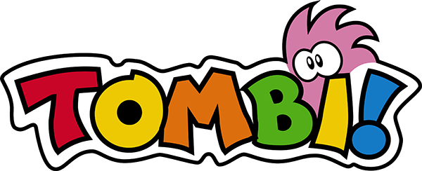
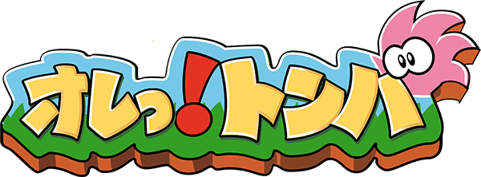

<p align="center">&nbsp;&nbsp;</p>

# Tombi! (Tomba!) decomp

| Version | Code | Data | Functions |
|---|---|---|---|
| Europe, Spanish (`SCES_013.31`) | [](https://decomp.dev/afsenovilla/Tombi-Decomp/SCES_013.31) | [](https://decomp.dev/afsenovilla/Tombi-Decomp/SCES_013.31) | [](https://decomp.dev/afsenovilla/Tombi-Decomp/SCES_013.31) |
| Japan (*Ore! Tomba*) | in preparation, see [docs/JP.md](docs/JP.md) | | |
| Japan demo (`SLPM-80165`) | split only, see [docs/JPDEMO.md](docs/JPDEMO.md) | | |

[](https://github.com/afsenovilla/Tombi-Decomp/actions/workflows/report.yml)
[](#target)
[](#how-matching-works)
[](LICENSE)

A work-in-progress **matching decompilation** of *Tombi!* (known as *Tomba!* in North America and
*Ore! Tomba* in Japan) for the original PlayStation. The goal is C source code that compiles, with the
game's original toolchain, into byte-identical machine code.

This repository targets the **European Spanish release** and works function by function: every
function in `src/` is verified to produce exactly the same instructions as the retail executable.

> This repository contains no game data, executables, disc images or Sony SDK files.
> You need your own legally obtained copy of the game and of the toolchain.

[](https://decomp.dev/afsenovilla/Tombi-Decomp)

<sub>Each rectangle is a unit sized by its code; green means it matches. Click for the details on decomp.dev.</sub>

## Status

<!-- progress:start -->
**Whole game: 96.66 % of the game's code matches byte for byte** (1478180 of 1529276 bytes).

| Part | Code | Matching bytes | Matching |
|---|---:|---:|---|
| MAIN0.EXE: engine, shared by every area | 286644 B | 286644 B | 100.0 % `[########################]` |
| X000.BIN: AREA00 + object code reused by all areas | 312708 B | 312708 B | 100.0 % `[########################]` |
| X001..X019.BIN: code specific to the other areas | 736440 B | 736440 B | 100.0 % `[########################]` |
| SYSTEM/*.BIN: options, sub-screens, game over, info screens | 193484 B | 142388 B | 73.6 % `[##################......]` |
| **Whole game** | **1529276 B** | **1478180 B** | **96.66 %** `[#######################.]` |

- Bytes of machine code in game functions, counted exactly like the objdiff report on decomp.dev (`tools/units.py` is the common list); Sony's Psy-Q library (100816 B) is not counted: 67176 B of it (66.6 %) also matches, from Psy-Q sources ported from psx_tomba, and is tracked apart.
- Each function counts once. The 16 area overlays share about 4800 functions with MAIN0/X000 or with each
  other; those copies match automatically and are not added again (counting every copy separately gives 98.4 %).
- Also tracked for MAIN0 + X000: 92.4 % of the code named by us, 74.9 % typed with the TObj structure.
<!-- progress:end -->

Per-program and per-area breakdown, pending work and what is not counted: [docs/PROGRESS.md](docs/PROGRESS.md).
The table above is regenerated with `python3 tools/progress.py`.

## Target

| File | Description | SHA-1 |
|------|-------------|-------|
| `SCES_013.31` | Boot executable (PAL, Spanish) | `f6c383514e5d8367d2eed06400315cf6dd57ef6b` |
| `EXE/MAIN0.EXE` | Game core, loaded at `0x80010000` | `bec8dc5f4116f5e497f2337eef8c523ff6dee8fc` |
| `AREA00/X000.BIN` | Area overlay, AREA00 (Village of All Beginnings), loaded at `0x800E8028` | `ce168475f667f2ca8842eabad2aec829e301c5c5` |
| `AREA01/X001.BIN` | Area overlay, AREA01 (also AREA07), loaded at `0x800E8028` | `923f812dcfd7da18ee0f7017e5b45a5e38ee3015` |
| `AREA02/X002.BIN` | Area overlay, AREA02 (AREA19 ships a copy), loaded at `0x800E8028` | `646aa8b5ad97f70b299b982b3260f9f731a142bb` |
| `AREA03/X003.BIN` | Area overlay, AREA03 (Phoenix Mountain), loaded at `0x800E8028` | `440ae76f5012e3778b908743d7d030c350caf7d3` |
| `AREA04/X004.BIN` | Area overlay, AREA04 (also AREA12), loaded at `0x800E8028` | `f01c882217efee45bf76aba54ee4fadfa6c25665` |
| `AREA05/X005.BIN` | Area overlay, AREA05 (Baccus Village), loaded at `0x800E8028` | `0d2778c0d4b3e5b5dfc40fc46053e46d9d785b17` |
| `AREA06/X006.BIN` | Area overlay, AREA06 (Dirt Motocross), loaded at `0x800E8028` | `1bd5b648feb75a580c14db6715e057cb035c1db1` |
| `AREA08/X008.BIN` | Area overlay, AREA08 (Baccus Lake), loaded at `0x800E8028` | `5e098dccfd123af09967ca778c83223e8a21716d` |
| `AREA09/X009.BIN` | Area overlay, AREA09 (Mushroom Village), loaded at `0x800E8028` | `1b44ea24890128c3d3789b0badb252135ba4dec1` |
| `AREA10/X010.BIN` | Area overlay, AREA10 (Deep Jungle), loaded at `0x800E8028` | `5093e40399319f5987668bfb1d042713216d356e` |
| `AREA11/X011.BIN` | Area overlay, AREA11 (Village of Civilization), loaded at `0x800E8028` | `016559470c5a253deb5a38f685ff312c39c2cb46` |
| `AREA13/X013.BIN` | Area overlay, AREA13 (Pig Island), loaded at `0x800E8028` | `a4e8668eca85a32d6d0cdfa05ddffd6ad40bfbb0` |
| `AREA14/X014.BIN` | Area overlay, AREA14 (Evil Pigs), loaded at `0x800E8028` | `4ee916eb3215ccae64773e1a9a547ab8dbcd1ff5` |
| `AREA16/X016.BIN` | Area overlay, AREA16 (Village of Civilization: Clock Tower), loaded at `0x800E8028` | `7c93915bc943e8d9d8fa5d5efbd02f7e563650e4` |
| `AREA17/X017.BIN` | Area overlay, AREA17 (Village of Civilization: Iron Tower), loaded at `0x800E8028` | `59c5964cbb4536bc62b1a65262d963fab1ad3d33` |
| `AREA18/X018.BIN` | Area overlay, AREA18 (Village of Civilization: Y Crossing), loaded at `0x800E8028` | `83eca42eb30944bb0c61056632b2ef7bb9891b34` |
| `AREA19/X019.BIN` | Area overlay, AREA19 (Village of Civilization (purified)), loaded at `0x800E8028` | `94060c10f7b6e3af1adc55a0c9cff4b81890988c` |

The 17 area overlays (`X0nn.BIN`, Spanish; `X1nn`..`X8nn` are the other languages) are raw code blobs, all
loaded at `0x800E8028`. Their first 188 KB (`0x800E8028`..`0x80115EA4`: header, ~300 shared object handlers and
a data block) are byte-identical in every area; the rest is per-area code. X001..X019 are tracked like X000:
boundaries in `notes/functions_x0nn.csv`, sources in `src/x0nn/` (`// FUNC addr size X0nn`), and functions
identical to an already matched MAIN0/X000 function are generated by `tools/areas.py twins`.

`MAIN0.EXE` corresponds to `SCUS_942.36` of the NTSC-U release (same functions, shifted addresses).
See [notes/disc_layout.md](notes/disc_layout.md), [notes/memory_map_main0.md](notes/memory_map_main0.md)
and [notes/overlays.md](notes/overlays.md).

## How matching works

Each function lives in its own file, `src/<Name>.c`, with a small header:

```c
// FUNC 8001fddc 48 MAIN0        address, size, program
// MATCHING 8001fddc 48          added once the bytes match
```

Optional header lines: `// FLAGS -O2 -G0 ...` (compiler flags) and `// CC gcc-2.8.1` (compiler, by old-gcc release
name; the default is `gcc-2.7.2`). A few MAIN0 library objects (0x8006xxxx) were built with the newer GCC 2.8.1
(Psy-Q 4.4): `ncheck.py`, `build_full.py` and `build_report.py` compile those with `/opt/oldgcc/gcc-2.8.1-psx`, and
`matchcheck.py` with Psy-Q 4.4 `CC1PSX.EXE` (`/opt/psyq/cc44/`).

Two checkers compile the file and compare the result with the retail binary, masking relocations:

| Tool | Toolchain | Use |
|------|-----------|-----|
| `tools/ncheck.py` | native `gcc-2.7.2-psx` cc1 + [maspsx](https://github.com/mkst/maspsx) + GNU `as` | fast iteration (seconds) |
| `tools/matchcheck.py` | original PSY-Q 4.3 `CC1PSX.EXE` (Wine) + `CPPPSX` (DOSBox) + `ASPSX 2.86` | reference check |

The game was built with the **PSY-Q 4.3 C compiler (GCC 2.7.2.SN.1)**; see
[notes/compiler.md](notes/compiler.md). Practical recipes for reproducing GCC 2.7.2 output are collected
in [notes/matching_guide.md](notes/matching_guide.md).

## Getting started

Requirements: Linux, Python 3, `binutils-mipsel-linux-gnu`. Optional: Wine + DOSBox and the PSY-Q SDK
binaries for the reference checker; Ghidra 12.1.4 + JDK 21 for analysis.

```bash
# 1. Put your own game files in game/ (ignored by git)
#    game/SCES_013.31, game/MAIN0.EXE, game/AREA00/X000.BIN

# 2. Fast native toolchain (old-gcc + maspsx + binutils)
tools/setup_native.sh

# 3. Check one function, or all of them
python3 tools/ncheck.py src/MulCos.c
python3 tools/ncheck.py src/*.c
python3 tools/ncheck.py src/x0*/*.c       # area overlays X001..X019

# 4. Inspect a function: disassembly + Ghidra pseudo-C
python3 tools/fn.py 8001fddc
```

Reference checker: copy `CC1PSX.EXE` (PSY-Q 4.3) to `/opt/psyq/cc43/` (and PSY-Q 4.4's to `/opt/psyq/cc44/` for the
`// CC gcc-2.8.1` files), the DOS `CPPPSX.EXE` to
`/opt/psyq/new/` and `ASPSX.EXE` 2.86 to `/opt/psyq/46/BIN/`, install `wine` and `dosbox`, then run
`python3 tools/matchcheck.py src/<Name>.c`.

## Full build

`tools/build_full.py` links both programs from the matched C plus splat assembly for everything else and
checks them against the retail files:

```bash
python3 tools/build_full.py          # splat split + compile src/*.c + link; prints SHA-1 and OK/FAIL
python3 tools/build_full.py --no-split   # reuse the previous split (build/full/asm)
```

Run `tools/setup_native.sh` first (toolchain and the `include/tomba/psyq` headers; without them the files that
include those headers are kept as asm, the output still matches). A full run takes about 1.5 minutes.

Outputs: `build/MAIN0.EXE` (must equal `bec8dc5f…`) and `build/X000.BIN` (must equal `ce168475…`); work files
in `build/full/` (linker scripts `*.full.ld`, maps, objects). On a mismatch it lists the first differing
offsets and the function or splat range that produced them.

- Each `src/*.c` replaces the splat lines in `[addr, addr+size)` of its `// FUNC` header (the header is the
  truth, even when splat had cut that range into several functions).
- String literals, jump tables and static data of a C file are linked at their original addresses (found from
  the retail bytes of the instructions that reference them). Data a file merely *re-defines* (globals ported
  from psx_tomba headers) is dropped in favour of the real data from splat, and every external symbol of a C
  file gets its retail address (`PROVIDE` in the linker script, renamed when the name belongs to another
  address, e.g. NTSC-named symbols).
- X000 is linked at `0x800E8028`; MAIN0 symbols it uses are absolute (`build/full/undefined_*_auto.x000.txt`).
- A file that does not compile or cannot be placed is reported as `WARN ... kept as asm` and the build still
  links the retail assembly for it. Today only `FUN_80068ae4` (a BIOS stub in the 0x8006xxxx library range
  whose inline `asm` ends in `.data`; it needs ASPSX) stays as asm.
- Rules for new C files: a data table shared by several functions must be referenced as an `extern` symbol in
  each file (it can only be linked once), and do not emit another function's data with `__asm__(".word")`.

## Versions

| Version | Serial | Status |
|---------|--------|--------|
| Tombi! PAL (Spanish) | SCES-01331 | matching, everything above |
| Ore! Tomba (Japan) | SLPS-01144 | split + shared C, 50.5 % of code (objdiff), see [docs/JP.md](docs/JP.md) |
| Ore! Tomba demo (Japan, taikenban) | SLPM-80165 | split + shared C, 39.6 % of code (objdiff), see [docs/JPDEMO.md](docs/JPDEMO.md) |

All versions live in this repository and appear on decomp.dev as versions of one project: the CI uploads one
`<serial>_report` artifact per version.

### How the versions share code

The repository follows the usual PS1 multi-version layout (as in sotn-decomp and psx_tomba): **one `src/` tree is
compiled for every version**, and each version has its own splat configs, symbol tables and asm.

| Version | `--version` (old alias) | Macro | splat configs / symbols | asm | report |
|---------|------------------------|-------|-------------------------|-----|--------|
| SCES-01331 (PAL, reference) | `sces01331` (default) | `VERSION_SCES_01331` | `config/*.yaml` | `asm/<prog>/` | `build/report.json` |
| SLPS-01144 (Japan) | `slps01144` (`jp`) | `VERSION_SLPS_01144` | `config/slps01144/` | `asm/slps01144/<prog>/` | `build/slps01144/report.json` |
| SLPM-80165 (Japan demo) | `slpm80165` (`jpdemo`) | `VERSION_SLPM_80165` | `config/slpm80165/` | `asm/slpm80165/<prog>/` | `build/slpm80165/report.json` |

- The C keeps the PAL names. `config/<serial>/symbol_addrs_<prog>.txt` maps PAL names to that version's addresses
  (`tools/jpdemo_syms.py`); names that only exist in a version carry the serial (`func_8011F5AC_slps01144`).
- The build defines the version macro (`tools/ncheck.py` `EXTRA_CPP`; `tools/build_report.py --version <v>` sets it).
  `INCLUDE_ASM_V("<prog>/nonmatchings/<prog>", name)` (`include/tomba/include_asm.h`) resolves against the asm dir
  of the version being built.
- A version function the PAL C matches as is just reuses the PAL file (pairing from the symbol tables and
  `config/<serial>/reuse.txt`). A function that differs gets a branch in the PAL file, plus a
  `// VERSION <SERIAL> <prog> <addr> <size>` header line (and optional `// FLAGS.<SERIAL>` / `// CC.<SERIAL>` lines):
  ```c
  // FUNC 800ef490 84 X000
  // MATCHING 800ef490 84
  // VERSION SLPS_01144 x00 800EF5FC 84
  #if defined(VERSION_SLPS_01144)
  ... Japanese C, or INCLUDE_ASM_V(...) while it is not matched ...
  #else
  ... PAL C ...
  #endif
  ```
- Version-only functions (the demo's stubs and debug code, JP-only helpers) live in the shared tree too, next to
  the PAL files of the same program, as `<name>_<serial>.c` whose whole body is inside `#if defined(VERSION_...)`.
- `tools/version_share.py` writes these blocks: `fold <version> <file.c>` folds a standalone version file into the
  shared tree, `asm <version>` adds the INCLUDE_ASM branches for the PAL files whose version counterpart is not
  matched yet. The PAL build is unaffected (it never defines the other macros).

## Progress report (objdiff / decomp.dev)

`tools/build_report.py` produces the [objdiff](https://github.com/encounter/objdiff) report that
[decomp.dev](https://decomp.dev) displays: [splat](https://github.com/ethteck/splat) splits the retail
binaries into one assembly file per function (`config/main0.yaml`, `config/x000.yaml`, `config/x0nn.yaml`
for the 16 area overlays), each function is assembled as the *target* object, each `src/*.c` and
`src/x0nn/*.c` is compiled as the *base* object, and `objdiff-cli` compares them (`build/report.json`).
The report and `docs/PROGRESS.md` count exactly the same bytes: both take their unit list from
`tools/units.py` (every matched source file as one unit, plus the csv functions no file covers), game code only
(the Psy-Q library is left out unless `--with-sdk` is given) and every shared overlay function counted once, so
the decomp.dev headline is the whole-game figure to the second decimal. The GitHub Actions workflow `.github/workflows/report.yml` runs it on every push; it
needs a `GAME_FILES_URL` secret (and `GAME_FILES_URL_JP` / `GAME_FILES_URL_JP_DEMO` for the Japanese release / demo) pointing to your own disc image (or a zip with `MAIN0.EXE` and
`AREA00/X000.BIN`, which limits the report to those two).

Units are marked `complete` (decomp.dev "fully linked", `complete_code`) when their object is linked into
MAIN0.EXE / X000.BIN by `tools/build_full.py` and matches 100 % of its code. Overlay units are not (the overlays are not
yet linked from source), and no data is claimed: `.data`/`.rodata` still come from the retail binary via splat.

## Repository layout

```
src/            matching C, one function per file (MAIN0 and X000)
src/x0nn/       matching C of the other area overlays (X001..X019), mostly generated twins of src/
src/wip/        unfinished attempts (not counted as progress)
include/        shared headers (tobj.h: game object struct)
include/tomba/  headers from psx_tomba (see THIRD_PARTY_NOTICES.md)
notes/          memory maps, structures, function lists and names, guides
docs/           generated progress report and charts
ghidra/scripts/ Ghidra scripts (headless pipeline, struct and name import)
config/         splat configurations for MAIN0.EXE and the X0nn.BIN overlays
.github/        CI workflow that publishes the objdiff report
tools/          checkers, progress report, analysis helpers, setup scripts
game/           your own game files (ignored by git)
game_jp/        your own Japanese disc files (ignored by git; game_jpdemo/ for the demo)
config/slps01144/  splat configs and symbol tables of the Japanese release (config/slpm80165/: the demo)
```

## Tools

| Tool | Purpose |
|------|---------|
| `tools/ncheck.py` | Fast native compile-and-compare (`--score`, `--asm`, `--mark`) |
| `tools/matchcheck.py` | Reference compile-and-compare with the original PSY-Q binaries |
| `tools/build_full.py` | Full build of MAIN0.EXE and X000.BIN, byte-for-byte check against the retail files |
| `tools/fn.py` | Disassembly (capstone) and Ghidra pseudo-C of one function |
| `tools/areas.py` | Area overlays: function boundaries (`bounds`), copies of matched twins (`twins`) |
| `tools/progress.py` | Regenerates `docs/PROGRESS.md` and the SVG charts |
| `tools/units.py` | The unit list shared by `progress.py`, `gen_symbols.py` and `build_report.py` (prints the totals) |
| `tools/classify.py` | Separates complete functions from Ghidra fragments (`notes/todo_match3.csv`) |
| `tools/fixbounds.py` | Detects functions Ghidra split incorrectly |
| `tools/permute.py` | Small random permuter (CPU only) for near-misses |
| `tools/ghidra_pipeline.sh` | Headless Ghidra: import, apply names and structs, export pseudo-C |
| `tools/setup_ghidra.sh`, `tools/setup_native.sh` | Toolchain installers |
| `tools/psxexe_info.py` | Prints the PS-X EXE header |
| `tools/wfm.py` | Assets: WFM font/dialogue files <-> YAML + glyph PNGs, byte-exact round trip (369/369) through a [TombaTools](https://github.com/hansbonini/tombatools) fork |
| `tools/wfm_py.py` | Assets: pure-Python WFM codec (no Go): dialogues as readable text with tags (`{NL} {CLEAR} {WAIT} {BOX w h} {PAUSE n} {COLOR n}`...), glyph table, byte-exact round trip on 369/369 files (`--check`); characters come from `tools/wfm_charmap.json` (bitmap hashes, made by `wfm_charmap_gen.py`) |
| `tools/text_editor.py` | Text editor with live preview (tkinter; logic in `text_core.py`, `text_preview.py`): open the disc image, edit dialogues drawn with the game font in a mock box (x1/x2/x3, red warnings for lines too wide, too many lines, >128 glyphs), save/load JSON project, export/import TXT/JSON, **Generar ISO** (re-encodes the WFM and runs `mkdisc.py --relayout`); Windows build `dist/windows/tombi-text.exe` (bundles mkpsxiso) |
| `tools/gfx_editor.py` | Graphics editor (tkinter; logic in `gfx_core.py`): open the disc image, browse screens, the `UiSpriteDef` table of MAIN0 (NOW / LOADING), VRAM pages per load list, WPP sprite frames and CLUT palettes with their real colours, rectangle overlay, export/import indexed PNG (RGB(A) PNG is quantised to the palette), palette editing (15 bit, shared-palette warning), undo, in-context preview, **composed room views** (tree node "Vista compuesta": every room as the game draws it + the sky/far background alone, captured on demand by running the game in `tools/psxemu` and cached in the user cache folder; needs the `.bin` image and numpy), save/load mod (`mods/<name>/mod.json` + PNG, the `mod.py` format), **Build ISO**; UI language selector (`i18n.py`); Windows build `dist/windows/tombi-gfx.exe` (bundles mkpsxiso). Tests: `tools/test_gfx.py` |
| `tools/gam_py.py` | Assets: pure-Python GAM encoder (the decoder is `area000.gam_unpack`), valid streams, original bytes kept for unchanged data; used by `mod.py` and the graphics editor so no Go is needed |
| `tools/i18n.py` | UI languages of the Windows tools (es, en, fr, de, it, pt): catalogs, system language detection, choice saved in `%APPDATA%/TombiTools/settings.json` |
| `tools/gam.py` | Assets: GAM (the game's LZ) unpack/pack; `--check` runs the whole round trip (816 files) |
| `tools/mkdisc.py` | Assets: rebuilds the `.bin/.cue` from `game/disc/fs` with mkpsxiso, SHA-1 identical to the original (`--check`) |
| `tools/cdfiles.py` | Assets: the LBA/size file table inside `EXE/MAIN0..8.EXE` (`dump`, `check` against an image, `update` from a new layout); used by `mkdisc.py build --relayout` |
| `tools/area000.py` | Assets: `AREAxx/*.000` and `SYSTEM/*.000` (uncompressed VRAM images, WPP/WMD tables, APD grids): `info`, `unpack` (+PNG views), `pack`, `--check` (286/286 identical); format in `notes/formats.md` |
| `tools/room.py` | Assets: room models (WMD, kind 0x50): flat PNG render (`AREA00:1 out.png`, `--all`) and 3D glTF export (`--glb AREA00:1 out.glb`, `--glb-all DIR`; texture atlas, vertex colours; opens in Blender / Windows 3D Viewer); also written to `rooms/` and `rooms3d/` by `extract_sprites` |
| `tools/anim.py` | Assets: Tombi's animations: decodes the 90-entry animation table (overlay `0x800E8404` -> scripts in MAIN0 data) into a catalogue (id, name, frames, ticks, loop; 82 distinct scripts, 36 named), `list [--json]`, `export OUT` (animated GIF + PNG strip per animation + `catalog.json`; also step `animations` of `extract_sprites`); preview window with play/pause/step/speed/loop/zoom/GIF export in the graphics editor (node "Animaciones", `anim_player.py`) |
| `tools/wpp.py` | Assets: WPP sprite frames (flag-byte RLE, 4 bpp): `info`, `unpack` (indexed PNG with the Tombi CLUT), `pack`, `--check` (40/40 files identical); `area000.py page` exports room pages with their CLUT |
| `tools/vram.py` | Assets: VRAM simulation of every load list (GRPX pages, CLUTs, GAM images at their LoadImage position) and the SPR frame definitions cut out of it (`--all OUT`: atlas parts, composed frames, flat pages, 1024x512 snapshots; `snapshot AREA00:1 x.png`; `--stats`) |
| `tools/sprclut.py` | Assets: per frame texture page offset and CLUT of SPR frames as the game code sets them: item descriptors of `initItemObject` (`DAT_8007B14C`: tpage offset `w1e`, CLUT override `w08` when `b0d & 1`, money bag palettes) and the page that owns a palette strip; used by `vram.py` (`items` lists them) |
| `tools/psxemu/clutmap.py` | Assets: runs the game in `tools/psxemu` (title, memory card screen, first room, pause menu, item menu, map), records every textured primitive and resolves texels and palette to disc files; writes `tools/ui_cluts.py` (generated table, only coordinates/file names), which `vram.py` / `screens.py` use for HUD, menus and fonts drawn by code |
| `tools/audio.py` | Assets: sound, pure Python: `.WVD` banks -> every VAB sample as WAV (PS1 ADPCM, loop points as `smpl` chunk) + tone table, `.SEQ` (`pQES`) -> MIDI type 0 (kept in `sound/music`, useful for editing), software sequencer (numpy) that renders each SEQ with its bank (mapping in `SEQ_BANK`) to stereo 44.1 kHz audio in `sound/music_audio` (loop played twice, fade out), XA audio of the `.STR` movies -> WAV (bit-exact vs ffmpeg); `--audio-format wav|mp3` for all audio (mp3 via `lameenc`, 192 kbps, falls back to WAV; loop `smpl` points only in WAV); `all Tombi.bin OUT`, `music Tombi.bin OUT`, `render X.SEQ X.WVD OUT.wav` |
| `tools/str.py` | Assets: `.STR` movies: demux + pure Python MDEC decoder (BS v2/v3, matches ffmpeg at about 49 dB): `info`, `frames` (PNG sequence, ~0.2 s/frame), `mp4` (needs ffmpeg in PATH), `avi`, `all` (AVI + mp4 when ffmpeg exists) |
| `tools/extract_sprites.py` | One-shot: every graphic of the game as PNG straight from a retail disc image (WPP frames, SPR atlas cuts, pages and VRAM snapshots; no dependencies) plus sound (`sound/`: WAV, MIDI) and movie AVI/audio (`video/`); choose what to extract: window with checkboxes per group (Sprites, Screens, VRAM pages, Rooms PNG/3D, Sound banks, Music MIDI, Rendered music, Movie audio, Videos; selector WAV / MP3) or `--only sprites,rooms3d,...` and `--audio-format wav|mp3` on the command line (steps: files sprites animations screens vram rooms rooms3d banks music music_audio movie_audio videos; each makes its own prerequisites); Windows build in `dist/windows/tombi-assets.exe` |
| `tools/mod.py` | Assets: mods (`mods/<name>/mod.json` + PNG patches + `mods/load_order.json`) applied to a copy of `game/disc/fs` (GRPX pages/CLUTs, WPP frames; GAM re-packed), then `mkdisc.py build --relayout`; layout idea from TombaPatcher (US) |
| `tools/overlay_data.py` | Assets: data layout of the area overlays `X0nn.BIN` (`summary`, `dump`, `header`, `strings`), see `notes/overlays.md` |

**Assets.** `wfm.py`, `gam.py` and `mkdisc.py` work on your own disc (`game/disc/Tombi.bin` and the files extracted to
`game/disc/fs`, never committed) and call outside tools: a PAL fork of TombaTools (Go, not vendored; `TOMBATOOLS`
defaults to `/opt/psyq/tombatools-pal`) and mkpsxiso/dumpsxiso 2.30 (`MKPSXISO_DIR`). `wfm.py --check` gives 369/369
identical WFM; `gam.py --check` reports how many of the 816 GAM files the re-compressor reproduces (743 by itself,
765 with its second variant, 816 when the original bytes are kept for unchanged data); `mkdisc.py --check` rebuilds
the image in `/tmp` and compares its SHA-1. Details in [notes/assets_tombatools.md](notes/assets_tombatools.md).

**Windows exes** (built by GitHub Actions on every change, no Python needed; your own disc image is required, nothing of the game is inside them):
- `dist/windows/tombi-assets.exe`: sprite/sound/video extractor (window with checkboxes).
- `dist/windows/tombi-text.exe`: text editor. Open `Tombi.bin` (or the extracted folder), pick an area/file/dialogue in the tree (search box on top),
  edit the text in the middle; the preview below redraws as you type with the game font at x1/x2/x3 and warns in red when a line is wider than the
  box, a page has more lines than the box height allows, or a page exceeds 128 characters. `Ajustar caja` rewrites `{BOX w h}` to fit.
  `Guardar/Cargar proyecto` keep your edits as JSON, `Exportar todo`/`Importar` use TXT or JSON, and `Generar ISO` writes a new `.bin`/`.cue`
  (needs about 1.5 GB of free disk for its work folder; the first run dumps the original disc). Only characters that exist in the game fonts can
  be typed (no `ü`, `:` or `%` in the PAL fonts): missing ones are borrowed from other files when possible, else the editor says so.
  Opening a folder instead of the image, or running without the bundled mkpsxiso, writes just the patched `.WFM` files plus instructions.
- `dist/windows/tombi-gfx.exe`: graphics editor. Open `Tombi.bin`; the tree on the left has Screens, Interface/HUD (the three plausible `UiSpriteDef`
  entries of MAIN0: 0 unused, 1 NOW, 2 LOADING), Pages by load list, Sprites (WPP frames) and Palettes (CLUT). The middle shows the page with the palette
  chosen in the right-hand list (x1..x8, optional sprite rectangles; click one or drag a region). `Export/Import PNG` work on the whole image or the
  selection: an indexed PNG with the same palette is used as is, an RGB(A) PNG is converted to the nearest palette colour (transparent = index 0 / word
  0x0000) with a warning when it has more than 16/256 colours. Clicking a palette swatch opens a colour chooser (15-bit colours, STP bit kept; a warning
  lists the other images that share the palette). `Save mod` writes `mods/<name>/mod.json` + PNGs that `python tools/mod.py build --mods <name>` also
  applies; `Build ISO` writes a new `.bin`/`.cue` (about 1.5 GB free; without mkpsxiso or with a folder it writes the changed files only).
- All three exes have an **Idioma / Language** selector (Español, English, Français, Deutsch, Italiano, Português; default = system language,
  saved in `%APPDATA%/TombiTools/settings.json`).

## Related projects

- [psx_tomba](https://github.com/hansbonini/psx_tomba) — decompilation of the NTSC-U release
  (`SCUS_942.36`) with a full splat/objdiff build. Its headers, names and some functions are reused here
  and re-verified against the PAL executable; see [THIRD_PARTY_NOTICES.md](THIRD_PARTY_NOTICES.md).

## License

Source code and documentation are released under the [MIT License](LICENSE).
Third-party material is listed in [THIRD_PARTY_NOTICES.md](THIRD_PARTY_NOTICES.md).

## Legal

This project contains only original source code written to reproduce the behaviour of the game, plus
documentation. *Tombi!* is © Whoopee Camp / Sony Computer Entertainment. No copyrighted game data or
SDK files are distributed.
