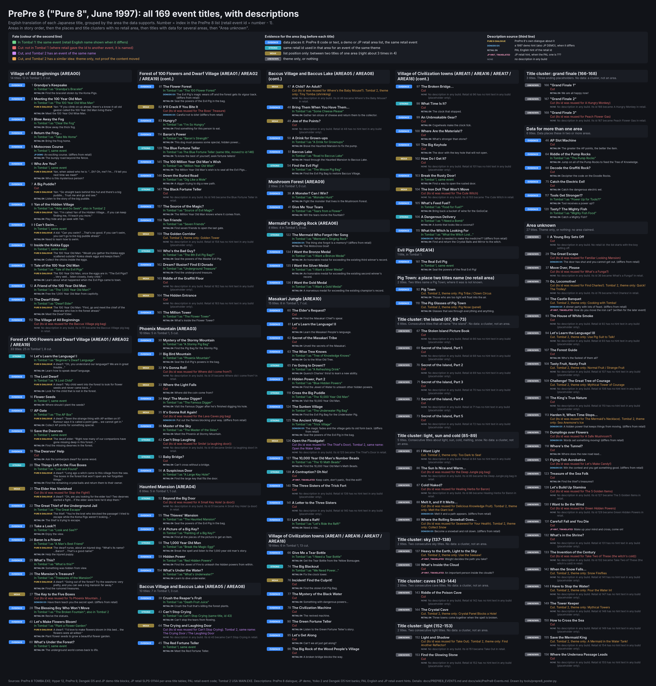

# PrePre 8 ("Pure 8") events

PrePre Vol. 8 (PCPX-96084, built 1997-06-24; the community calls it "Pure 8") is the oldest known Tomba! build. Its executable holds a list of 169 event titles, the earliest state of the game's event table. These pages place every title in an area where data supports it, rate that evidence, say what became of it in retail, and give every description of it found in any build.

Generated by `tools/prepre8_wiki.py` from the audited doc [PREPRE8_EVENTS.md](../PREPRE8_EVENTS.md) (the arguments and the method in full). Build background: [PREPRE8.md](../PREPRE8.md). Wiki home: [Home](Home.md).

The poster above shows all 169 titles on one sheet; click it to open it at full size. It is drawn by `tools/prepre8_poster.py` from the same doc.

## The id rule

Retail event id = PrePre 8 index - 1, for the whole list: 69 titles are the JP retail title of that id, only two match a retail title at another id (43 and 129). A cut title is an id that retail left untitled, or reused for a different event; retail ids 166 and up were added after the old list.

## Evidence levels

- **evidence** (87): data places it. PrePre 8 itself (its code constants, the area 0 room 0 record, the area-0 and Dwarf Village dialogue banks); a demo's area title block (Hyper 12, the JP demo and Dengeki have the same area-0 block: ids 0-12, 166, 167; PrePre 9's AREA01 / AREA02 and the JP demo's AREA08 have the same 30-title forest block); a JP retail per-area title table that holds the same title (see "The JP per-area title tables" for how far they are per area); or a retail event with the same JP title (near-same: one word or a number changed) that retail sets in that area (`docs/EVENTS_MAP.md`). Two titles name a place (51 Baccus Lake, 112 the Village of All Beginnings) and two name Pig Town.
- **strong** (19): the same retail id is used in that area for an event with a matching theme, but under another title and with no pre-release data.
- **weak** (16): list position only: the nearest titles on both sides with evidence or strong are of one area and at most 4 indexes apart. On the retail-matched titles this guess is right 16 times in 21 (see [the list order](../PREPRE8_EVENTS.md#is-the-list-ordered-by-area)).
- **unknown** (47): theme only, or nothing. These are under "Area unknown", or in a title cluster when consecutive titles share a theme (a cluster is not an area).

## Source tags

PrePre 8 has no event descriptions or hint bank: a scan of TOMBA.EXE and of every file of the disc (GAMs unpacked) for glyph tables of 5-byte records followed by u16 strings ending in 0xFFFE finds only the six known blocks (the title table and the five dialogue tables). So each description comes from the best source available, tagged. Priority: Pure 8 dialogue, Pure 9, the other demos, retail EN, JP hint (translated), none. Where an earlier build differs from retail, the earlier line comes first and says so.

| Tag | Source |
|---|---|
| Pure 8 dialogue | PrePre 8's own dialogue (TOMBA.EXE) talks about the event; translated. The forest bank's unlabelled kanji are read from the same lines in the JP demo's early forest bank. |
| Pure 9 | PrePre 9 (PCPX-96093, 1997-10-20). It has no event hint bank (its DSPSUB.BIN holds no WFM text block), so no description carries this tag. |
| JP demo / Yoiko 2 / Dengeki D5 | The hint bank of a 1997 JP demo (SLPM-80165 and Yoi Ko 2 `SYSTEM/A00014` / `A00013`, 1997-10-10; Dengeki D5 `SYSTEM/A00014`, 1997-11-06), translated. Shown only where it differs from the JP retail hint of the same id. Hyper 12 (1997-09-22) has no hint bank. |
| beta 980203 | The English hint of the 1998-02-03 prototype, quoted where its wording differs from retail. |
| retail EN | The PAL English hint of the retail id (the balloon of the event list, `D0SPSUB.BIN`), quoted. |
| JP hint (translated) | The JP retail hint (`DSPSUB.BIN` block 1) where the PAL English is a placeholder. |
| none | No description in any build; one factual line says what is known (a placeholder, or what the id became in retail). |

First (best) description per event: retail EN 83, none 49, Pure 8 dialogue 18, Dengeki D5 14, JP hint (translated) 4, JP demo 1.

## Overview

| Group | Titles | In retail | Cut | of which a Tomba! 2 idea | evidence | strong | weak | unknown |
| --- | --- | --- | --- | --- | --- | --- | --- | --- |
| [Village of All Beginnings (AREA00)](PrePre8-Events-Village-of-All-Beginnings.md) | 14 | 12 | 2 | 0 | 14 | 0 | 0 | 0 |
| [Forest of 100 Flowers and Dwarf Village (AREA01 / AREA02 / AREA19)](PrePre8-Events-Forest-and-Dwarf-Village.md) | 33 | 25 | 8 | 1 | 22 | 5 | 6 | 0 |
| [Phoenix Mountain (AREA03)](PrePre8-Events-Phoenix-Mountain.md) | 10 | 5 | 5 | 0 | 5 | 2 | 3 | 0 |
| [Haunted Mansion (AREA04)](PrePre8-Events-Haunted-Mansion.md) | 6 | 5 | 1 | 0 | 4 | 2 | 0 | 0 |
| [Baccus Village and Baccus Lake (AREA05 / AREA08)](PrePre8-Events-Baccus-Village-and-Lake.md) | 10 | 7 | 3 | 2 | 5 | 2 | 3 | 0 |
| [Mushroom Forest (AREA09)](PrePre8-Events-Mushroom-Forest.md) | 2 | 2 | 0 | 0 | 2 | 0 | 0 | 0 |
| [Mermaid's Singing Rock (AREA06)](PrePre8-Events-Mermaids-Singing-Rock.md) | 4 | 4 | 0 | 0 | 3 | 1 | 0 | 0 |
| [Masakari Jungle (AREA10)](PrePre8-Events-Masakari-Jungle.md) | 15 | 8 | 7 | 1 | 10 | 4 | 1 | 0 |
| [Village of Civilization towns (AREA11 / AREA16 / AREA17 / AREA18)](PrePre8-Events-Civilization-Towns.md) | 19 | 6 | 13 | 0 | 13 | 3 | 3 | 0 |
| [Evil Pigs (AREA14)](PrePre8-Events-Evil-Pigs.md) | 1 | 1 | 0 | 0 | 1 | 0 | 0 | 0 |
| [Pig Town: a place two titles name (no retail area)](PrePre8-Events-Pig-Town.md) | 2 | 0 | 2 | 2 | 2 | 0 | 0 | 0 |
| [Title cluster: the island (67, 69-73)](PrePre8-Events-Cluster-Island.md) | 6 | 0 | 6 | 0 | 0 | 0 | 0 | 6 |
| [Title cluster: light, sun and cold (85-89)](PrePre8-Events-Cluster-Light-Sun-and-Cold.md) | 5 | 0 | 5 | 3 | 0 | 0 | 0 | 5 |
| [Title cluster: sky (137-138)](PrePre8-Events-Cluster-Sky.md) | 2 | 0 | 2 | 1 | 0 | 0 | 0 | 2 |
| [Title cluster: caves (143-144)](PrePre8-Events-Cluster-Caves.md) | 2 | 0 | 2 | 1 | 0 | 0 | 0 | 2 |
| [Title cluster: light (152-153)](PrePre8-Events-Cluster-Light.md) | 2 | 0 | 2 | 1 | 0 | 0 | 0 | 2 |
| [Title cluster: grand finale (166-168)](PrePre8-Events-Cluster-Grand-Finale.md) | 3 | 0 | 3 | 0 | 0 | 0 | 0 | 3 |
| [Data for more than one area](PrePre8-Events-Several-Areas.md) | 6 | 3 | 3 | 0 | 6 | 0 | 0 | 0 |
| [Area unknown](PrePre8-Events-Area-Unknown.md) | 27 | 0 | 27 | 10 | 0 | 0 | 0 | 27 |
| **All** | **169** | **78** | **91** | **22** | **87** | **19** | **16** | **47** |

By fate: 61 same, 15 renamed, 2 with the same title at another id, 91 cut (28 of them with the id reused by another retail event). Tomba! 2: 4 titles share a name with a Tomba! 2 event (8, 28, 44, 126), 21 share a theme only. Best description per title (first in the "Description (source)" column, the beta's English draft not counted): retail EN 83, none 49, Pure 8 dialogue 18, Dengeki D5 14, JP hint (translated) 4, JP demo 1.

## Area pages

- [Village of All Beginnings (AREA00)](PrePre8-Events-Village-of-All-Beginnings.md): 14 titles: 12 in retail, 2 cut; 14 evidence.
- [Forest of 100 Flowers and Dwarf Village (AREA01 / AREA02 / AREA19)](PrePre8-Events-Forest-and-Dwarf-Village.md): 33 titles: 25 in retail, 8 cut; 22 evidence, 5 strong, 6 weak.
- [Phoenix Mountain (AREA03)](PrePre8-Events-Phoenix-Mountain.md): 10 titles: 5 in retail, 5 cut; 5 evidence, 2 strong, 3 weak.
- [Haunted Mansion (AREA04)](PrePre8-Events-Haunted-Mansion.md): 6 titles: 5 in retail, 1 cut; 4 evidence, 2 strong.
- [Baccus Village and Baccus Lake (AREA05 / AREA08)](PrePre8-Events-Baccus-Village-and-Lake.md): 10 titles: 7 in retail, 3 cut; 5 evidence, 2 strong, 3 weak.
- [Mushroom Forest (AREA09)](PrePre8-Events-Mushroom-Forest.md): 2 titles: 2 in retail, 0 cut; 2 evidence.
- [Mermaid's Singing Rock (AREA06)](PrePre8-Events-Mermaids-Singing-Rock.md): 4 titles: 4 in retail, 0 cut; 3 evidence, 1 strong.
- [Masakari Jungle (AREA10)](PrePre8-Events-Masakari-Jungle.md): 15 titles: 8 in retail, 7 cut; 10 evidence, 4 strong, 1 weak.
- [Village of Civilization towns (AREA11 / AREA16 / AREA17 / AREA18)](PrePre8-Events-Civilization-Towns.md): 19 titles: 6 in retail, 13 cut; 13 evidence, 3 strong, 3 weak.
- [Evil Pigs (AREA14)](PrePre8-Events-Evil-Pigs.md): 1 titles: 1 in retail, 0 cut; 1 evidence.
- [Pig Town: a place two titles name (no retail area)](PrePre8-Events-Pig-Town.md): 2 titles: 0 in retail, 2 cut; 2 evidence.
- [Title cluster: the island (67, 69-73)](PrePre8-Events-Cluster-Island.md): 6 titles: 0 in retail, 6 cut; 6 unknown.
- [Title cluster: light, sun and cold (85-89)](PrePre8-Events-Cluster-Light-Sun-and-Cold.md): 5 titles: 0 in retail, 5 cut; 5 unknown.
- [Title cluster: sky (137-138)](PrePre8-Events-Cluster-Sky.md): 2 titles: 0 in retail, 2 cut; 2 unknown.
- [Title cluster: caves (143-144)](PrePre8-Events-Cluster-Caves.md): 2 titles: 0 in retail, 2 cut; 2 unknown.
- [Title cluster: light (152-153)](PrePre8-Events-Cluster-Light.md): 2 titles: 0 in retail, 2 cut; 2 unknown.
- [Title cluster: grand finale (166-168)](PrePre8-Events-Cluster-Grand-Finale.md): 3 titles: 0 in retail, 3 cut; 3 unknown.
- [Data for more than one area](PrePre8-Events-Several-Areas.md): 6 titles: 3 in retail, 3 cut; 6 evidence.
- [Area unknown](PrePre8-Events-Area-Unknown.md): 27 titles: 0 in retail, 27 cut; 27 unknown.

Also: [Tomba! 2 links](PrePre8-Tomba2-Links.md) · [Candies](PrePre8-Candies.md) · [Proto Village of Civilization candidates](PrePre8-Civilization-Candidates.md)

## All 169 events

| # | English | Fate | Area | Level |
|---|---|---|---|---|
| 0 | [A Young Boy Sets Off](PrePre8-Events-Area-Unknown.md#0-a-young-boy-sets-off) | cut | [Area unknown](PrePre8-Events-Area-Unknown.md) | unknown |
| 1 | [Grandpa's Keepsake](PrePre8-Events-Village-of-All-Beginnings.md#1-grandpas-keepsake) | same event | [Village of All Beginnings (AREA00)](PrePre8-Events-Village-of-All-Beginnings.md) | evidence |
| 2 | [Meeting the 100 Year Old Man](PrePre8-Events-Village-of-All-Beginnings.md#2-meeting-the-100-year-old-man) | same event | [Village of All Beginnings (AREA00)](PrePre8-Events-Village-of-All-Beginnings.md) | evidence |
| 3 | [Blow Away the Fog](PrePre8-Events-Village-of-All-Beginnings.md#3-blow-away-the-fog) | same event | [Village of All Beginnings (AREA00)](PrePre8-Events-Village-of-All-Beginnings.md) | evidence |
| 4 | [Return the Frog...](PrePre8-Events-Village-of-All-Beginnings.md#4-return-the-frog) | same event | [Village of All Beginnings (AREA00)](PrePre8-Events-Village-of-All-Beginnings.md) | evidence |
| 5 | [Motocross Course](PrePre8-Events-Village-of-All-Beginnings.md#5-motocross-course) | same event | [Village of All Beginnings (AREA00)](PrePre8-Events-Village-of-All-Beginnings.md) | evidence |
| 6 | [Who Are You?](PrePre8-Events-Village-of-All-Beginnings.md#6-who-are-you) | same event | [Village of All Beginnings (AREA00)](PrePre8-Events-Village-of-All-Beginnings.md) | evidence |
| 7 | [A Big Puddle?](PrePre8-Events-Village-of-All-Beginnings.md#7-a-big-puddle) | cut | [Village of All Beginnings (AREA00)](PrePre8-Events-Village-of-All-Beginnings.md) | evidence |
| 8 | [Yan of the Hidden Village](PrePre8-Events-Village-of-All-Beginnings.md#8-yan-of-the-hidden-village) | same event | [Village of All Beginnings (AREA00)](PrePre8-Events-Village-of-All-Beginnings.md) | evidence |
| 9 | [I Can't Swim...](PrePre8-Events-Village-of-All-Beginnings.md#9-i-cant-swim) | same event | [Village of All Beginnings (AREA00)](PrePre8-Events-Village-of-All-Beginnings.md) | evidence |
| 10 | [Inside the Kokka Eggs](PrePre8-Events-Village-of-All-Beginnings.md#10-inside-the-kokka-eggs) | same event | [Village of All Beginnings (AREA00)](PrePre8-Events-Village-of-All-Beginnings.md) | evidence |
| 11 | [Tale of the 100 Year Old Man](PrePre8-Events-Village-of-All-Beginnings.md#11-tale-of-the-100-year-old-man) | same event | [Village of All Beginnings (AREA00)](PrePre8-Events-Village-of-All-Beginnings.md) | evidence |
| 12 | [A Friend of the 100 Year Old Man](PrePre8-Events-Village-of-All-Beginnings.md#12-a-friend-of-the-100-year-old-man) | same event | [Village of All Beginnings (AREA00)](PrePre8-Events-Village-of-All-Beginnings.md) | evidence |
| 13 | [The Dwarf Elder](PrePre8-Events-Village-of-All-Beginnings.md#13-the-dwarf-elder) | same event | [Village of All Beginnings (AREA00)](PrePre8-Events-Village-of-All-Beginnings.md) | evidence |
| 14 | [Let's Learn the Language! I](PrePre8-Events-Forest-and-Dwarf-Village.md#14-lets-learn-the-language-i) | renamed | [Forest of 100 Flowers and Dwarf Village (AREA01 / AREA02 / AREA19)](PrePre8-Events-Forest-and-Dwarf-Village.md) | strong |
| 15 | [The Lost Dwarf](PrePre8-Events-Forest-and-Dwarf-Village.md#15-the-lost-dwarf) | same event | [Forest of 100 Flowers and Dwarf Village (AREA01 / AREA02 / AREA19)](PrePre8-Events-Forest-and-Dwarf-Village.md) | evidence |
| 16 | [Flower Seeds](PrePre8-Events-Forest-and-Dwarf-Village.md#16-flower-seeds) | same event | [Forest of 100 Flowers and Dwarf Village (AREA01 / AREA02 / AREA19)](PrePre8-Events-Forest-and-Dwarf-Village.md) | evidence |
| 17 | [AP Gate](PrePre8-Events-Forest-and-Dwarf-Village.md#17-ap-gate) | renamed | [Forest of 100 Flowers and Dwarf Village (AREA01 / AREA02 / AREA19)](PrePre8-Events-Forest-and-Dwarf-Village.md) | evidence |
| 18 | [Save the Dwarves](PrePre8-Events-Forest-and-Dwarf-Village.md#18-save-the-dwarves) | same event | [Forest of 100 Flowers and Dwarf Village (AREA01 / AREA02 / AREA19)](PrePre8-Events-Forest-and-Dwarf-Village.md) | evidence |
| 19 | [The Dwarves' Help](PrePre8-Events-Forest-and-Dwarf-Village.md#19-the-dwarves-help) | cut | [Forest of 100 Flowers and Dwarf Village (AREA01 / AREA02 / AREA19)](PrePre8-Events-Forest-and-Dwarf-Village.md) | evidence |
| 20 | [The Things Left in the Five Boxes](PrePre8-Events-Forest-and-Dwarf-Village.md#20-the-things-left-in-the-five-boxes) | renamed | [Forest of 100 Flowers and Dwarf Village (AREA01 / AREA02 / AREA19)](PrePre8-Events-Forest-and-Dwarf-Village.md) | strong |
| 21 | [The Elder Has Vanished](PrePre8-Events-Forest-and-Dwarf-Village.md#21-the-elder-has-vanished) | cut, id reused | [Forest of 100 Flowers and Dwarf Village (AREA01 / AREA02 / AREA19)](PrePre8-Events-Forest-and-Dwarf-Village.md) | weak |
| 22 | [The Great Thief of the Underground Jail](PrePre8-Events-Forest-and-Dwarf-Village.md#22-the-great-thief-of-the-underground-jail) | same event | [Forest of 100 Flowers and Dwarf Village (AREA01 / AREA02 / AREA19)](PrePre8-Events-Forest-and-Dwarf-Village.md) | evidence |
| 23 | [Take a Look?!](PrePre8-Events-Forest-and-Dwarf-Village.md#23-take-a-look) | same event | [Forest of 100 Flowers and Dwarf Village (AREA01 / AREA02 / AREA19)](PrePre8-Events-Forest-and-Dwarf-Village.md) | evidence |
| 24 | [Baron Is a Friend](PrePre8-Events-Forest-and-Dwarf-Village.md#24-baron-is-a-friend) | same event | [Forest of 100 Flowers and Dwarf Village (AREA01 / AREA02 / AREA19)](PrePre8-Events-Forest-and-Dwarf-Village.md) | evidence |
| 25 | [What's This?](PrePre8-Events-Forest-and-Dwarf-Village.md#25-whats-this) | same event | [Forest of 100 Flowers and Dwarf Village (AREA01 / AREA02 / AREA19)](PrePre8-Events-Forest-and-Dwarf-Village.md) | evidence |
| 26 | [The Mansion's Treasure?](PrePre8-Events-Forest-and-Dwarf-Village.md#26-the-mansions-treasure) | same event | [Forest of 100 Flowers and Dwarf Village (AREA01 / AREA02 / AREA19)](PrePre8-Events-Forest-and-Dwarf-Village.md) | evidence |
| 27 | [The Key to the Five Boxes](PrePre8-Events-Forest-and-Dwarf-Village.md#27-the-key-to-the-five-boxes) | cut, id reused | [Forest of 100 Flowers and Dwarf Village (AREA01 / AREA02 / AREA19)](PrePre8-Events-Forest-and-Dwarf-Village.md) | weak |
| 28 | [The Blessing Boy Who Won't Move](PrePre8-Events-Forest-and-Dwarf-Village.md#28-the-blessing-boy-who-wont-move) | same event | [Forest of 100 Flowers and Dwarf Village (AREA01 / AREA02 / AREA19)](PrePre8-Events-Forest-and-Dwarf-Village.md) | evidence |
| 29 | [The Great Escape](PrePre8-Events-Area-Unknown.md#29-the-great-escape) | cut, id reused | [Area unknown](PrePre8-Events-Area-Unknown.md) | unknown |
| 30 | [Mystery of the Stormy Mountain](PrePre8-Events-Phoenix-Mountain.md#30-mystery-of-the-stormy-mountain) | same event | [Phoenix Mountain (AREA03)](PrePre8-Events-Phoenix-Mountain.md) | evidence |
| 31 | [Big Bird Mountain](PrePre8-Events-Phoenix-Mountain.md#31-big-bird-mountain) | same event | [Phoenix Mountain (AREA03)](PrePre8-Events-Phoenix-Mountain.md) | evidence |
| 32 | [It's Gonna Roll!](PrePre8-Events-Phoenix-Mountain.md#32-its-gonna-roll) | cut, id reused | [Phoenix Mountain (AREA03)](PrePre8-Events-Phoenix-Mountain.md) | weak |
| 33 | [Where the Light Falls](PrePre8-Events-Phoenix-Mountain.md#33-where-the-light-falls) | cut | [Phoenix Mountain (AREA03)](PrePre8-Events-Phoenix-Mountain.md) | weak |
| 34 | [Hey! The Master Digger!](PrePre8-Events-Phoenix-Mountain.md#34-hey-the-master-digger) | same event | [Phoenix Mountain (AREA03)](PrePre8-Events-Phoenix-Mountain.md) | evidence |
| 35 | [It's Gonna Roll Again!](PrePre8-Events-Phoenix-Mountain.md#35-its-gonna-roll-again) | cut, id reused | [Phoenix Mountain (AREA03)](PrePre8-Events-Phoenix-Mountain.md) | weak |
| 36 | [Master of the Sky](PrePre8-Events-Phoenix-Mountain.md#36-master-of-the-sky) | same event | [Phoenix Mountain (AREA03)](PrePre8-Events-Phoenix-Mountain.md) | evidence |
| 37 | [Move Over, Please](PrePre8-Events-Area-Unknown.md#37-move-over-please) | cut, id reused | [Area unknown](PrePre8-Events-Area-Unknown.md) | unknown |
| 38 | [A Monster? Can I Win?](PrePre8-Events-Mushroom-Forest.md#38-a-monster-can-i-win) | same event | [Mushroom Forest (AREA09)](PrePre8-Events-Mushroom-Forest.md) | evidence |
| 39 | [Crush the Reaper's Fruit](PrePre8-Events-Baccus-Village-and-Lake.md#39-crush-the-reapers-fruit) | same event | [Baccus Village and Baccus Lake (AREA05 / AREA08)](PrePre8-Events-Baccus-Village-and-Lake.md) | evidence |
| 40 | [Let's Make Flowers Bloom!](PrePre8-Events-Forest-and-Dwarf-Village.md#40-lets-make-flowers-bloom) | same event | [Forest of 100 Flowers and Dwarf Village (AREA01 / AREA02 / AREA19)](PrePre8-Events-Forest-and-Dwarf-Village.md) | evidence |
| 41 | [Give Me Your Tears](PrePre8-Events-Mushroom-Forest.md#41-give-me-your-tears) | same event | [Mushroom Forest (AREA09)](PrePre8-Events-Mushroom-Forest.md) | evidence |
| 42 | [Can't Stop Laughing](PrePre8-Events-Phoenix-Mountain.md#42-cant-stop-laughing) | cut, id reused | [Phoenix Mountain (AREA03)](PrePre8-Events-Phoenix-Mountain.md) | strong |
| 43 | [Can't Stop Crying](PrePre8-Events-Baccus-Village-and-Lake.md#43-cant-stop-crying) | same title, other id | [Baccus Village and Baccus Lake (AREA05 / AREA08)](PrePre8-Events-Baccus-Village-and-Lake.md) | strong |
| 44 | [The Crying and Laughing Door](PrePre8-Events-Baccus-Village-and-Lake.md#44-the-crying-and-laughing-door) | cut, id reused | [Baccus Village and Baccus Lake (AREA05 / AREA08)](PrePre8-Events-Baccus-Village-and-Lake.md) | weak |
| 45 | [The Red Fortune Teller](PrePre8-Events-Baccus-Village-and-Lake.md#45-the-red-fortune-teller) | same event | [Baccus Village and Baccus Lake (AREA05 / AREA08)](PrePre8-Events-Baccus-Village-and-Lake.md) | evidence |
| 46 | [AP Slot Machine](PrePre8-Events-Several-Areas.md#46-ap-slot-machine) | cut | [Data for more than one area](PrePre8-Events-Several-Areas.md) | evidence |
| 47 | [A Child? An Adult?](PrePre8-Events-Baccus-Village-and-Lake.md#47-a-child-an-adult) | cut, id reused | [Baccus Village and Baccus Lake (AREA05 / AREA08)](PrePre8-Events-Baccus-Village-and-Lake.md) | weak |
| 48 | [Bring Them When You Have Them...](PrePre8-Events-Baccus-Village-and-Lake.md#48-bring-them-when-you-have-them) | same event | [Baccus Village and Baccus Lake (AREA05 / AREA08)](PrePre8-Events-Baccus-Village-and-Lake.md) | evidence |
| 49 | [Joe of the Points?](PrePre8-Events-Baccus-Village-and-Lake.md#49-joe-of-the-points) | cut | [Baccus Village and Baccus Lake (AREA05 / AREA08)](PrePre8-Events-Baccus-Village-and-Lake.md) | weak |
| 50 | [A Drink for Grown-ups](PrePre8-Events-Baccus-Village-and-Lake.md#50-a-drink-for-grown-ups) | same event | [Baccus Village and Baccus Lake (AREA05 / AREA08)](PrePre8-Events-Baccus-Village-and-Lake.md) | evidence |
| 51 | [Baccus Lake](PrePre8-Events-Baccus-Village-and-Lake.md#51-baccus-lake) | renamed | [Baccus Village and Baccus Lake (AREA05 / AREA08)](PrePre8-Events-Baccus-Village-and-Lake.md) | evidence |
| 52 | [Beyond the Big Door](PrePre8-Events-Haunted-Mansion.md#52-beyond-the-big-door) | cut, id reused | [Haunted Mansion (AREA04)](PrePre8-Events-Haunted-Mansion.md) | strong |
| 53 | [Baby Bridge?](PrePre8-Events-Phoenix-Mountain.md#53-baby-bridge) | cut | [Phoenix Mountain (AREA03)](PrePre8-Events-Phoenix-Mountain.md) | strong |
| 54 | [Find the Evil Pig!](PrePre8-Events-Baccus-Village-and-Lake.md#54-find-the-evil-pig) | renamed | [Baccus Village and Baccus Lake (AREA05 / AREA08)](PrePre8-Events-Baccus-Village-and-Lake.md) | strong |
| 55 | [The Thieves' Mansion](PrePre8-Events-Haunted-Mansion.md#55-the-thieves-mansion) | renamed | [Haunted Mansion (AREA04)](PrePre8-Events-Haunted-Mansion.md) | evidence |
| 56 | [A Suspicious Door](PrePre8-Events-Phoenix-Mountain.md#56-a-suspicious-door) | same event | [Phoenix Mountain (AREA03)](PrePre8-Events-Phoenix-Mountain.md) | evidence |
| 57 | [A Picture of a Big Key?](PrePre8-Events-Haunted-Mansion.md#57-a-picture-of-a-big-key) | same event | [Haunted Mansion (AREA04)](PrePre8-Events-Haunted-Mansion.md) | evidence |
| 58 | [The 1,000 Year Old Man](PrePre8-Events-Haunted-Mansion.md#58-the-1000-year-old-man) | renamed | [Haunted Mansion (AREA04)](PrePre8-Events-Haunted-Mansion.md) | strong |
| 59 | [Hidden Power](PrePre8-Events-Haunted-Mansion.md#59-hidden-power) | same event | [Haunted Mansion (AREA04)](PrePre8-Events-Haunted-Mansion.md) | evidence |
| 60 | [The Elder's Request?](PrePre8-Events-Masakari-Jungle.md#60-the-elders-request) | cut | [Masakari Jungle (AREA10)](PrePre8-Events-Masakari-Jungle.md) | evidence |
| 61 | [Let's Learn the Language! II](PrePre8-Events-Masakari-Jungle.md#61-lets-learn-the-language-ii) | cut | [Masakari Jungle (AREA10)](PrePre8-Events-Masakari-Jungle.md) | evidence |
| 62 | [Secret of the Masakari Tribe](PrePre8-Events-Masakari-Jungle.md#62-secret-of-the-masakari-tribe) | cut | [Masakari Jungle (AREA10)](PrePre8-Events-Masakari-Jungle.md) | evidence |
| 63 | [The Wise Tree Knows](PrePre8-Events-Masakari-Jungle.md#63-the-wise-tree-knows) | same event | [Masakari Jungle (AREA10)](PrePre8-Events-Masakari-Jungle.md) | evidence |
| 64 | [Riddle of the Pump Rocks](PrePre8-Events-Several-Areas.md#64-riddle-of-the-pump-rocks) | same event | [Data for more than one area](PrePre8-Events-Several-Areas.md) | evidence |
| 65 | [I'm Going to Drown!?](PrePre8-Events-Masakari-Jungle.md#65-im-going-to-drown) | renamed | [Masakari Jungle (AREA10)](PrePre8-Events-Masakari-Jungle.md) | strong |
| 66 | [Give Me a Tear Bottle](PrePre8-Events-Civilization-Towns.md#66-give-me-a-tear-bottle) | same event | [Village of Civilization towns (AREA11 / AREA16 / AREA17 / AREA18)](PrePre8-Events-Civilization-Towns.md) | evidence |
| 67 | [The Stolen Island Picture Book](PrePre8-Events-Cluster-Island.md#67-the-stolen-island-picture-book) | cut | [Title cluster: the island (67, 69-73)](PrePre8-Events-Cluster-Island.md) | unknown |
| 68 | [Decode the Graffiti Rock?](PrePre8-Events-Several-Areas.md#68-decode-the-graffiti-rock) | cut | [Data for more than one area](PrePre8-Events-Several-Areas.md) | evidence |
| 69 | [Secret of the Island, Part 1](PrePre8-Events-Cluster-Island.md#69-secret-of-the-island-part-1) | cut | [Title cluster: the island (67, 69-73)](PrePre8-Events-Cluster-Island.md) | unknown |
| 70 | [Secret of the Island, Part 2](PrePre8-Events-Cluster-Island.md#70-secret-of-the-island-part-2) | cut | [Title cluster: the island (67, 69-73)](PrePre8-Events-Cluster-Island.md) | unknown |
| 71 | [Secret of the Island, Part 3](PrePre8-Events-Cluster-Island.md#71-secret-of-the-island-part-3) | cut | [Title cluster: the island (67, 69-73)](PrePre8-Events-Cluster-Island.md) | unknown |
| 72 | [Secret of the Island, Part 4](PrePre8-Events-Cluster-Island.md#72-secret-of-the-island-part-4) | cut | [Title cluster: the island (67, 69-73)](PrePre8-Events-Cluster-Island.md) | unknown |
| 73 | [Secret of the Island, Part 5](PrePre8-Events-Cluster-Island.md#73-secret-of-the-island-part-5) | cut | [Title cluster: the island (67, 69-73)](PrePre8-Events-Cluster-Island.md) | unknown |
| 74 | [The Big Blackout](PrePre8-Events-Civilization-Towns.md#74-the-big-blackout) | renamed | [Village of Civilization towns (AREA11 / AREA16 / AREA17 / AREA18)](PrePre8-Events-Civilization-Towns.md) | strong |
| 75 | [Catch the Electric Eel!](PrePre8-Events-Several-Areas.md#75-catch-the-electric-eel) | cut | [Data for more than one area](PrePre8-Events-Several-Areas.md) | evidence |
| 76 | [Incident! Find the Culprit!](PrePre8-Events-Civilization-Towns.md#76-incident-find-the-culprit) | cut | [Village of Civilization towns (AREA11 / AREA16 / AREA17 / AREA18)](PrePre8-Events-Civilization-Towns.md) | weak |
| 77 | [The Mystery of the Black Water](PrePre8-Events-Civilization-Towns.md#77-the-mystery-of-the-black-water) | cut | [Village of Civilization towns (AREA11 / AREA16 / AREA17 / AREA18)](PrePre8-Events-Civilization-Towns.md) | evidence |
| 78 | [The Civilization Machine](PrePre8-Events-Civilization-Towns.md#78-the-civilization-machine) | cut | [Village of Civilization towns (AREA11 / AREA16 / AREA17 / AREA18)](PrePre8-Events-Civilization-Towns.md) | evidence |
| 79 | [Go, Locomotive!](PrePre8-Events-Area-Unknown.md#79-go-locomotive) | cut, id reused | [Area unknown](PrePre8-Events-Area-Unknown.md) | unknown |
| 80 | [What's Under the Forest?](PrePre8-Events-Forest-and-Dwarf-Village.md#80-whats-under-the-forest) | same event | [Forest of 100 Flowers and Dwarf Village (AREA01 / AREA02 / AREA19)](PrePre8-Events-Forest-and-Dwarf-Village.md) | evidence |
| 81 | [The Flower Forest](PrePre8-Events-Forest-and-Dwarf-Village.md#81-the-flower-forest) | same event | [Forest of 100 Flowers and Dwarf Village (AREA01 / AREA02 / AREA19)](PrePre8-Events-Forest-and-Dwarf-Village.md) | evidence |
| 82 | [It'll Crack If You Bite It](PrePre8-Events-Forest-and-Dwarf-Village.md#82-itll-crack-if-you-bite-it) | cut, id reused | [Forest of 100 Flowers and Dwarf Village (AREA01 / AREA02 / AREA19)](PrePre8-Events-Forest-and-Dwarf-Village.md) | weak |
| 83 | [Hungry?](PrePre8-Events-Forest-and-Dwarf-Village.md#83-hungry) | same event | [Forest of 100 Flowers and Dwarf Village (AREA01 / AREA02 / AREA19)](PrePre8-Events-Forest-and-Dwarf-Village.md) | evidence |
| 84 | [The Castle Banquet](PrePre8-Events-Area-Unknown.md#84-the-castle-banquet) | cut | [Area unknown](PrePre8-Events-Area-Unknown.md) | unknown |
| 85 | [I Want Light](PrePre8-Events-Cluster-Light-Sun-and-Cold.md#85-i-want-light) | cut | [Title cluster: light, sun and cold (85-89)](PrePre8-Events-Cluster-Light-Sun-and-Cold.md) | unknown |
| 86 | [The Sun Is Nice and Warm...](PrePre8-Events-Cluster-Light-Sun-and-Cold.md#86-the-sun-is-nice-and-warm) | cut, id reused | [Title cluster: light, sun and cold (85-89)](PrePre8-Events-Cluster-Light-Sun-and-Cold.md) | unknown |
| 87 | [Cold! Naked?](PrePre8-Events-Cluster-Light-Sun-and-Cold.md#87-cold-naked) | cut, id reused | [Title cluster: light, sun and cold (85-89)](PrePre8-Events-Cluster-Light-Sun-and-Cold.md) | unknown |
| 88 | [Melt It, and If It Melts...](PrePre8-Events-Cluster-Light-Sun-and-Cold.md#88-melt-it-and-if-it-melts) | cut, id reused | [Title cluster: light, sun and cold (85-89)](PrePre8-Events-Cluster-Light-Sun-and-Cold.md) | unknown |
| 89 | [Where the Rolling Snowball Goes...](PrePre8-Events-Cluster-Light-Sun-and-Cold.md#89-where-the-rolling-snowball-goes) | cut, id reused | [Title cluster: light, sun and cold (85-89)](PrePre8-Events-Cluster-Light-Sun-and-Cold.md) | unknown |
| 90 | [The Green Fortune Teller](PrePre8-Events-Civilization-Towns.md#90-the-green-fortune-teller) | cut | [Village of Civilization towns (AREA11 / AREA16 / AREA17 / AREA18)](PrePre8-Events-Civilization-Towns.md) | evidence |
| 91 | [Hidden Power, Part 2](PrePre8-Events-Masakari-Jungle.md#91-hidden-power-part-2) | same event | [Masakari Jungle (AREA10)](PrePre8-Events-Masakari-Jungle.md) | evidence |
| 92 | [Pig Town](PrePre8-Events-Pig-Town.md#92-pig-town) | cut | [Pig Town: a place two titles name (no retail area)](PrePre8-Events-Pig-Town.md) | evidence |
| 93 | [The House of White Smoke](PrePre8-Events-Area-Unknown.md#93-the-house-of-white-smoke) | cut | [Area unknown](PrePre8-Events-Area-Unknown.md) | unknown |
| 94 | [Let's Learn the Language! III](PrePre8-Events-Area-Unknown.md#94-lets-learn-the-language-iii) | cut | [Area unknown](PrePre8-Events-Area-Unknown.md) | unknown |
| 95 | [Let's Get Along](PrePre8-Events-Civilization-Towns.md#95-lets-get-along) | cut | [Village of Civilization towns (AREA11 / AREA16 / AREA17 / AREA18)](PrePre8-Events-Civilization-Towns.md) | evidence |
| 96 | [The Big Rock of the Wood People's Village](PrePre8-Events-Civilization-Towns.md#96-the-big-rock-of-the-wood-peoples-village) | cut | [Village of Civilization towns (AREA11 / AREA16 / AREA17 / AREA18)](PrePre8-Events-Civilization-Towns.md) | evidence |
| 97 | [The Broken Bridge...](PrePre8-Events-Civilization-Towns.md#97-the-broken-bridge) | cut | [Village of Civilization towns (AREA11 / AREA16 / AREA17 / AREA18)](PrePre8-Events-Civilization-Towns.md) | evidence |
| 98 | [What Time Is It?](PrePre8-Events-Civilization-Towns.md#98-what-time-is-it) | cut | [Village of Civilization towns (AREA11 / AREA16 / AREA17 / AREA18)](PrePre8-Events-Civilization-Towns.md) | strong |
| 99 | [An Unbreakable Gear?](PrePre8-Events-Civilization-Towns.md#99-an-unbreakable-gear) | cut | [Village of Civilization towns (AREA11 / AREA16 / AREA17 / AREA18)](PrePre8-Events-Civilization-Towns.md) | evidence |
| 100 | [Where Are the Materials!?](PrePre8-Events-Civilization-Towns.md#100-where-are-the-materials) | cut | [Village of Civilization towns (AREA11 / AREA16 / AREA17 / AREA18)](PrePre8-Events-Civilization-Towns.md) | evidence |
| 101 | [The Big Keyhole](PrePre8-Events-Civilization-Towns.md#101-the-big-keyhole) | cut | [Village of Civilization towns (AREA11 / AREA16 / AREA17 / AREA18)](PrePre8-Events-Civilization-Towns.md) | evidence |
| 102 | [How Do I Get It?](PrePre8-Events-Civilization-Towns.md#102-how-do-i-get-it) | cut | [Village of Civilization towns (AREA11 / AREA16 / AREA17 / AREA18)](PrePre8-Events-Civilization-Towns.md) | weak |
| 103 | [Break the Rusty Door!](PrePre8-Events-Civilization-Towns.md#103-break-the-rusty-door) | same event | [Village of Civilization towns (AREA11 / AREA16 / AREA17 / AREA18)](PrePre8-Events-Civilization-Towns.md) | evidence |
| 104 | [The Iron Doll That Won't Move](PrePre8-Events-Civilization-Towns.md#104-the-iron-doll-that-wont-move) | cut, id reused | [Village of Civilization towns (AREA11 / AREA16 / AREA17 / AREA18)](PrePre8-Events-Civilization-Towns.md) | weak |
| 105 | [What's Feed Fuel?](PrePre8-Events-Civilization-Towns.md#105-whats-feed-fuel) | same event | [Village of Civilization towns (AREA11 / AREA16 / AREA17 / AREA18)](PrePre8-Events-Civilization-Towns.md) | evidence |
| 106 | [A Dangerous Delivery](PrePre8-Events-Civilization-Towns.md#106-a-dangerous-delivery) | renamed | [Village of Civilization towns (AREA11 / AREA16 / AREA17 / AREA18)](PrePre8-Events-Civilization-Towns.md) | strong |
| 107 | [The Forest Guide](PrePre8-Events-Area-Unknown.md#107-the-forest-guide) | cut | [Area unknown](PrePre8-Events-Area-Unknown.md) | unknown |
| 108 | [Tasty Fruit, Nasty Fruit](PrePre8-Events-Area-Unknown.md#108-tasty-fruit-nasty-fruit) | cut | [Area unknown](PrePre8-Events-Area-Unknown.md) | unknown |
| 109 | [Challenge! The Great Tree of Courage](PrePre8-Events-Area-Unknown.md#109-challenge-the-great-tree-of-courage) | cut | [Area unknown](PrePre8-Events-Area-Unknown.md) | unknown |
| 110 | [The Pig Glasses of Pig Town](PrePre8-Events-Pig-Town.md#110-the-pig-glasses-of-pig-town) | cut | [Pig Town: a place two titles name (no retail area)](PrePre8-Events-Pig-Town.md) | evidence |
| 111 | [The King's True Nature](PrePre8-Events-Area-Unknown.md#111-the-kings-true-nature) | cut | [Area unknown](PrePre8-Events-Area-Unknown.md) | unknown |
| 112 | [The Village of All Beginnings](PrePre8-Events-Village-of-All-Beginnings.md#112-the-village-of-all-beginnings) | cut, id reused | [Village of All Beginnings (AREA00)](PrePre8-Events-Village-of-All-Beginnings.md) | evidence |
| 113 | [Harden It, When Time Stops...](PrePre8-Events-Area-Unknown.md#113-harden-it-when-time-stops) | cut, id reused | [Area unknown](PrePre8-Events-Area-Unknown.md) | unknown |
| 114 | [Baron's Power](PrePre8-Events-Forest-and-Dwarf-Village.md#114-barons-power) | same event | [Forest of 100 Flowers and Dwarf Village (AREA01 / AREA02 / AREA19)](PrePre8-Events-Forest-and-Dwarf-Village.md) | evidence |
| 115 | [What the Witch Is Looking For](PrePre8-Events-Civilization-Towns.md#115-what-the-witch-is-looking-for) | same event | [Village of Civilization towns (AREA11 / AREA16 / AREA17 / AREA18)](PrePre8-Events-Civilization-Towns.md) | evidence |
| 116 | [Dumplings over Flowers](PrePre8-Events-Area-Unknown.md#116-dumplings-over-flowers) | cut, id reused | [Area unknown](PrePre8-Events-Area-Unknown.md) | unknown |
| 117 | [Tools Get Stronger!?](PrePre8-Events-Several-Areas.md#117-tools-get-stronger) | same event | [Data for more than one area](PrePre8-Events-Several-Areas.md) | evidence |
| 118 | [Where's the Tunnel?](PrePre8-Events-Area-Unknown.md#118-wheres-the-tunnel) | cut | [Area unknown](PrePre8-Events-Area-Unknown.md) | unknown |
| 119 | [Cross the Big Puddle](PrePre8-Events-Masakari-Jungle.md#119-cross-the-big-puddle) | renamed | [Masakari Jungle (AREA10)](PrePre8-Events-Masakari-Jungle.md) | strong |
| 120 | [Tasty? The Mighty Fish](PrePre8-Events-Several-Areas.md#120-tasty-the-mighty-fish) | same event | [Data for more than one area](PrePre8-Events-Several-Areas.md) | evidence |
| 121 | [Flying Fish Acrobatics](PrePre8-Events-Area-Unknown.md#121-flying-fish-acrobatics) | cut, id reused | [Area unknown](PrePre8-Events-Area-Unknown.md) | unknown |
| 122 | [The Mermaid Who Forgot Her Song](PrePre8-Events-Mermaids-Singing-Rock.md#122-the-mermaid-who-forgot-her-song) | renamed | [Mermaid's Singing Rock (AREA06)](PrePre8-Events-Mermaids-Singing-Rock.md) | strong |
| 123 | [Treasure of the Sea Folk](PrePre8-Events-Area-Unknown.md#123-treasure-of-the-sea-folk) | cut | [Area unknown](PrePre8-Events-Area-Unknown.md) | unknown |
| 124 | [The Sunken Village](PrePre8-Events-Masakari-Jungle.md#124-the-sunken-village) | same event | [Masakari Jungle (AREA10)](PrePre8-Events-Masakari-Jungle.md) | evidence |
| 125 | [The Ancient Village](PrePre8-Events-Masakari-Jungle.md#125-the-ancient-village) | renamed | [Masakari Jungle (AREA10)](PrePre8-Events-Masakari-Jungle.md) | strong |
| 126 | [Open the Floodgate!](PrePre8-Events-Masakari-Jungle.md#126-open-the-floodgate) | cut, id reused | [Masakari Jungle (AREA10)](PrePre8-Events-Masakari-Jungle.md) | weak |
| 127 | [The 10,000 Year Old Man's Number Beads](PrePre8-Events-Masakari-Jungle.md#127-the-10000-year-old-mans-number-beads) | same event | [Masakari Jungle (AREA10)](PrePre8-Events-Masakari-Jungle.md) | evidence |
| 128 | [Let's Build Up Stamina](PrePre8-Events-Area-Unknown.md#128-lets-build-up-stamina) | cut, id reused | [Area unknown](PrePre8-Events-Area-Unknown.md) | unknown |
| 129 | [The Blue Fortune Teller](PrePre8-Events-Forest-and-Dwarf-Village.md#129-the-blue-fortune-teller) | same title, other id | [Forest of 100 Flowers and Dwarf Village (AREA01 / AREA02 / AREA19)](PrePre8-Events-Forest-and-Dwarf-Village.md) | strong |
| 130 | [I Want to Be the Wind](PrePre8-Events-Area-Unknown.md#130-i-want-to-be-the-wind) | cut, id reused | [Area unknown](PrePre8-Events-Area-Unknown.md) | unknown |
| 131 | [Careful! Fall and You Die](PrePre8-Events-Area-Unknown.md#131-careful-fall-and-you-die) | cut | [Area unknown](PrePre8-Events-Area-Unknown.md) | unknown |
| 132 | [What's in the Shrine?](PrePre8-Events-Area-Unknown.md#132-whats-in-the-shrine) | cut | [Area unknown](PrePre8-Events-Area-Unknown.md) | unknown |
| 133 | [The Invention of the Century](PrePre8-Events-Area-Unknown.md#133-the-invention-of-the-century) | cut, id reused | [Area unknown](PrePre8-Events-Area-Unknown.md) | unknown |
| 134 | [I Want the Bronze Medal](PrePre8-Events-Mermaids-Singing-Rock.md#134-i-want-the-bronze-medal) | same event | [Mermaid's Singing Rock (AREA06)](PrePre8-Events-Mermaids-Singing-Rock.md) | evidence |
| 135 | [I Want the Silver Medal](PrePre8-Events-Mermaids-Singing-Rock.md#135-i-want-the-silver-medal) | same event | [Mermaid's Singing Rock (AREA06)](PrePre8-Events-Mermaids-Singing-Rock.md) | evidence |
| 136 | [I Want the Gold Medal](PrePre8-Events-Mermaids-Singing-Rock.md#136-i-want-the-gold-medal) | same event | [Mermaid's Singing Rock (AREA06)](PrePre8-Events-Mermaids-Singing-Rock.md) | evidence |
| 137 | [Heavy to the Earth, Light to the Sky](PrePre8-Events-Cluster-Sky.md#137-heavy-to-the-earth-light-to-the-sky) | cut | [Title cluster: sky (137-138)](PrePre8-Events-Cluster-Sky.md) | unknown |
| 138 | [What's Inside the Cloud](PrePre8-Events-Cluster-Sky.md#138-whats-inside-the-cloud) | cut | [Title cluster: sky (137-138)](PrePre8-Events-Cluster-Sky.md) | unknown |
| 139 | [A Contraption? Oh No!](PrePre8-Events-Masakari-Jungle.md#139-a-contraption-oh-no) | cut | [Masakari Jungle (AREA10)](PrePre8-Events-Masakari-Jungle.md) | strong |
| 140 | [The Three Sisters of the Trick Fort](PrePre8-Events-Masakari-Jungle.md#140-the-three-sisters-of-the-trick-fort) | cut | [Masakari Jungle (AREA10)](PrePre8-Events-Masakari-Jungle.md) | evidence |
| 141 | [A Letter to the Three Sisters](PrePre8-Events-Masakari-Jungle.md#141-a-letter-to-the-three-sisters) | cut | [Masakari Jungle (AREA10)](PrePre8-Events-Masakari-Jungle.md) | evidence |
| 142 | [When the Snow Falls...](PrePre8-Events-Area-Unknown.md#142-when-the-snow-falls) | cut | [Area unknown](PrePre8-Events-Area-Unknown.md) | unknown |
| 143 | [Riddle of the Poison Cave](PrePre8-Events-Cluster-Caves.md#143-riddle-of-the-poison-cave) | cut | [Title cluster: caves (143-144)](PrePre8-Events-Cluster-Caves.md) | unknown |
| 144 | [The Crystal Cave](PrePre8-Events-Cluster-Caves.md#144-the-crystal-cave) | cut | [Title cluster: caves (143-144)](PrePre8-Events-Cluster-Caves.md) | unknown |
| 145 | [The 100 Million Year Old Man's Wish](PrePre8-Events-Forest-and-Dwarf-Village.md#145-the-100-million-year-old-mans-wish) | same event | [Forest of 100 Flowers and Dwarf Village (AREA01 / AREA02 / AREA19)](PrePre8-Events-Forest-and-Dwarf-Village.md) | evidence |
| 146 | [Down the Buried Road](PrePre8-Events-Forest-and-Dwarf-Village.md#146-down-the-buried-road) | same event | [Forest of 100 Flowers and Dwarf Village (AREA01 / AREA02 / AREA19)](PrePre8-Events-Forest-and-Dwarf-Village.md) | evidence |
| 147 | [The Black Fortune Teller](PrePre8-Events-Forest-and-Dwarf-Village.md#147-the-black-fortune-teller) | cut, id reused | [Forest of 100 Flowers and Dwarf Village (AREA01 / AREA02 / AREA19)](PrePre8-Events-Forest-and-Dwarf-Village.md) | strong |
| 148 | [I Have to Stop the Water!](PrePre8-Events-Area-Unknown.md#148-i-have-to-stop-the-water) | cut | [Area unknown](PrePre8-Events-Area-Unknown.md) | unknown |
| 149 | [The Tower Keeper](PrePre8-Events-Area-Unknown.md#149-the-tower-keeper) | cut | [Area unknown](PrePre8-Events-Area-Unknown.md) | unknown |
| 150 | [How to Cross the Sea](PrePre8-Events-Area-Unknown.md#150-how-to-cross-the-sea) | cut | [Area unknown](PrePre8-Events-Area-Unknown.md) | unknown |
| 151 | [Let's Build a Raft!](PrePre8-Events-Masakari-Jungle.md#151-lets-build-a-raft) | renamed | [Masakari Jungle (AREA10)](PrePre8-Events-Masakari-Jungle.md) | evidence |
| 152 | [Light and Shadow](PrePre8-Events-Cluster-Light.md#152-light-and-shadow) | cut, id reused | [Title cluster: light (152-153)](PrePre8-Events-Cluster-Light.md) | unknown |
| 153 | [Find the Glowing Stone](PrePre8-Events-Cluster-Light.md#153-find-the-glowing-stone) | cut | [Title cluster: light (152-153)](PrePre8-Events-Cluster-Light.md) | unknown |
| 154 | [What's Under the Water?](PrePre8-Events-Haunted-Mansion.md#154-whats-under-the-water) | same event | [Haunted Mansion (AREA04)](PrePre8-Events-Haunted-Mansion.md) | evidence |
| 155 | [Save the Mermaid King](PrePre8-Events-Area-Unknown.md#155-save-the-mermaid-king) | cut | [Area unknown](PrePre8-Events-Area-Unknown.md) | unknown |
| 156 | [Where the Undersea Passage Leads](PrePre8-Events-Area-Unknown.md#156-where-the-undersea-passage-leads) | cut | [Area unknown](PrePre8-Events-Area-Unknown.md) | unknown |
| 157 | [The Source of the Magic?](PrePre8-Events-Forest-and-Dwarf-Village.md#157-the-source-of-the-magic) | same event | [Forest of 100 Flowers and Dwarf Village (AREA01 / AREA02 / AREA19)](PrePre8-Events-Forest-and-Dwarf-Village.md) | evidence |
| 158 | [Ten Friends](PrePre8-Events-Forest-and-Dwarf-Village.md#158-ten-friends) | same event | [Forest of 100 Flowers and Dwarf Village (AREA01 / AREA02 / AREA19)](PrePre8-Events-Forest-and-Dwarf-Village.md) | evidence |
| 159 | [The Golden Corridor](PrePre8-Events-Forest-and-Dwarf-Village.md#159-the-golden-corridor) | cut | [Forest of 100 Flowers and Dwarf Village (AREA01 / AREA02 / AREA19)](PrePre8-Events-Forest-and-Dwarf-Village.md) | weak |
| 160 | [Who's the Bad Guy?](PrePre8-Events-Forest-and-Dwarf-Village.md#160-whos-the-bad-guy) | renamed | [Forest of 100 Flowers and Dwarf Village (AREA01 / AREA02 / AREA19)](PrePre8-Events-Forest-and-Dwarf-Village.md) | strong |
| 161 | [The Real Evil Pig](PrePre8-Events-Evil-Pigs.md#161-the-real-evil-pig) | same event | [Evil Pigs (AREA14)](PrePre8-Events-Evil-Pigs.md) | evidence |
| 162 | [Dream? Illusion? Find El Dorado](PrePre8-Events-Forest-and-Dwarf-Village.md#162-dream-illusion-find-el-dorado) | same event | [Forest of 100 Flowers and Dwarf Village (AREA01 / AREA02 / AREA19)](PrePre8-Events-Forest-and-Dwarf-Village.md) | evidence |
| 163 | [Riddle of the Graffiti Floor](PrePre8-Events-Forest-and-Dwarf-Village.md#163-riddle-of-the-graffiti-floor) | cut | [Forest of 100 Flowers and Dwarf Village (AREA01 / AREA02 / AREA19)](PrePre8-Events-Forest-and-Dwarf-Village.md) | weak |
| 164 | [The Hidden Entrance](PrePre8-Events-Forest-and-Dwarf-Village.md#164-the-hidden-entrance) | cut | [Forest of 100 Flowers and Dwarf Village (AREA01 / AREA02 / AREA19)](PrePre8-Events-Forest-and-Dwarf-Village.md) | weak |
| 165 | [The Million Tower](PrePre8-Events-Forest-and-Dwarf-Village.md#165-the-million-tower) | same event | [Forest of 100 Flowers and Dwarf Village (AREA01 / AREA02 / AREA19)](PrePre8-Events-Forest-and-Dwarf-Village.md) | evidence |
| 166 | ["Grand Finale 1"](PrePre8-Events-Cluster-Grand-Finale.md#166-grand-finale-1) | cut | [Title cluster: grand finale (166-168)](PrePre8-Events-Cluster-Grand-Finale.md) | unknown |
| 167 | ["Grand Finale 2"](PrePre8-Events-Cluster-Grand-Finale.md#167-grand-finale-2) | cut, id reused | [Title cluster: grand finale (166-168)](PrePre8-Events-Cluster-Grand-Finale.md) | unknown |
| 168 | ["Grand Finale 3"](PrePre8-Events-Cluster-Grand-Finale.md#168-grand-finale-3) | cut, id reused | [Title cluster: grand finale (166-168)](PrePre8-Events-Cluster-Grand-Finale.md) | unknown |

## Title clusters and places that are not in retail

None of these has a retail area, and apart from the titles themselves there is no data: they are groups of titles,
not areas.

- **The island, 67 and 69-73** (cluster, consecutive): 67 盗まれた島の絵本 ("the stolen island picture book") and 69-73
  島のヒミツその1-5 ("secret of the island 1-5"). 68 解読?らくがき岩 sits inside the run; JP titles its id in the
  forest (X01) and Civilization (X16, X18) tables, and graffiti plaques exist in AREA01 / AREA04 rooms (CUT_CONTENT.md
  "Graffiti rocks"). The run lies between 66 and 74, both Civilization, but 8 indexes apart: too far for the weak rule.
  Which island is not said (the whole game is on one; retail's AREA13 is Pig Island, with no link shown).
- **Light, sun and cold, 85-89** (cluster, consecutive): 85 光がほしい ("I want light"), 86 おひさまポカポカ… ("the sun
  is nice and warm..."), 87 寒い!裸? ("cold! naked?"), 88 溶かす、溶ければ… ("melt it, and if it melts..."), 89
  雪玉ゴロゴロその先は… ("where the rolling snowball goes..."). Ids 84-88 are untitled or reused in retail (the
  jungle pig bag and three Dwarf Village errands), so retail says nothing about them. 142 雪がふったら… ("when the snow
  falls...") and 113 固める、止まった時に… ("harden it, when time stops...") share the theme but are not next to the
  run: unknown. A snow or cold area is a reading of these titles, not a known area. Tomba! 2 has snow and ice (Kujara
  Ranch "Collect Snow", "Snow Fireflies", "Melt the Giant Ice!"): theme only.
- **Pig Town** (a place two titles name): 92 ブタの町 ("Pig Town") and 110 ブタの町のブタメガネ ("the pig glasses of Pig
  Town"). That a Pig Town was planned is shown by the titles; where it was is not. The titles next to them (93
  白いケムリの家, 94 コトバをおぼえよう!Ⅲ, 107-109, 111 王の本性) share no pig theme and stay unknown. Tomba! 2's Pig Tribe,
  Clown Circus and pig suit ("Use Pig Suit to Talk!"): theme only.
- **Sky, 137-138** (cluster): 137 おもいは地、かるいは天 ("heavy to the earth, light to the sky") and 138 雲の中身 ("what's
  inside the cloud"). The earlier "sky / towers / light" group put 131, 132, 149, 152 and 153 with them; those are not
  consecutive with it and are now unknown, or the light pair below.
- **Caves, 143-144** (cluster): 143 毒毒どうくつのナゾ ("riddle of the poison cave"), 144 水晶のどうくつ ("the crystal cave").
- **Light, 152-153** (cluster): 152 光と影 ("light and shadow"), 153 光る石を探せ ("find the glowing stone").
- **Grand finale, 166-168** (cluster): 「大団円1-3」, three ending placeholders. Retail id 165 is untitled with the hint
  "before you know it, everyone is happy"; ids 166-167 were reused for area-0 additions.
- **Sea and mermaid titles** (121, 123, 148, 150, 155, 156): the sea has a retail area (AREA06), so they are not a
  cluster; none sits between two titles of one area, so they are unknown. 126 水門をあけろ! ("open the floodgate!") is
  weak jungle (between 125 and 127).
- 0 少年の旅立ち ("the boy sets off") has no retail id and no area data; it reads as the opening, which is a theme.

## Uncertain

- Every **weak** row: position only, right about three times in four on the retail-matched titles.
- Every **strong** row: the retail id and area are data, the shared theme is a reading.
- 43 涙が止まらない: the same title as retail 43 (Baccus), against the id rule's 42 (the mansion's crying door).
- The demos' area blocks and the JP tables are title lists: a title in a list shows where the event could be titled,
  and the lists are only about three-quarters per area (see above).
- The five kanji read from their slot alone (雲, 砦, 毒, 勇, 裸): plausible readings, not confirmed by a retail title.
- The JP title tables of AREA01 and AREA18 were read through the AREA13 and AREA11 lists (tools/jp_text.py skips the
  AREA01/A008 and AREA18/A003 title blocks); where those lists differ, the JP title shown was picked by hand.
- Tomba! 2: English USA titles only; "theme only" matches are not proof that the content moved.
